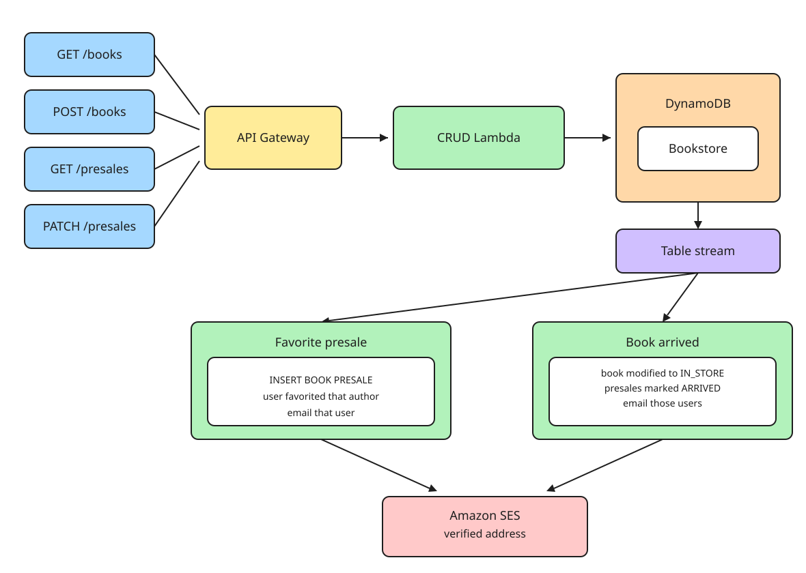

# Bookstore

Every request hits API Gateway, and API Gateway forwards all of them to one Lambda. Inside that Lambda, Powertools looks at the path and method and runs the matching CRUD function. boto3 reads and writes DynamoDB.

Powertools and `table_repository.py` live in a Lambda layer. AWS mounts that zip at `/opt/python`. The Crud zip only has the routes, the book and presale repositories, and the request models. `from table_repository import TableRepository` resolves from the layer.

Books and presales share one table, `Bookstore`. A book row and a reservation row are different items. The key prefix tells them apart.

## Columns

`pk` and `sk` are the address of the row. `entity` says if the row is a book or a reservation.

`gsi1pk` and `gsi1sk` are the address of that same row inside the `byAuthor` index. `gsi2pk` and `gsi2sk` are the address inside the `byAuthorName` index. They are copies used for search. A presale leaves `gsi2pk` and `gsi2sk` empty, so the name index returns only books.

`authorId` is one person. `authorName` is the name printed on the book. Two people can share a name.

| Column | Book | Presale | Holds |
|---|---|---|---|
| `pk` | yes | yes | Address of the row. |
| `sk` | yes | yes | Second part of that address. |
| `entity` | `BOOK` | `PRESALE` | Book or reservation. |
| `authorId` | yes | | One person. |
| `authorName` | yes | | Name printed on the book. |
| `title` | yes | | Book title. |
| `publishedAt` | yes | | When it was published. |
| `isFavorite` | yes | | Marked favorite or not. |
| `userId` | | yes | Who reserved the book. |
| `bookId` | | yes | Which book they reserved. |
| `status` | `PRESALE` or `IN_STORE` | `WAITING` or `ARRIVED` | See the next table. |
| `gsi1pk` | `AUTHOR#<authorId>` | `BOOK#<bookId>` | `byAuthor` search key. |
| `gsi1sk` | the publish date | `USER#<userId>` | `byAuthor` order. |
| `gsi2pk` | `AUTHORNAME#<authorName>` | | `byAuthorName` search key. |
| `gsi2sk` | the publish date | | `byAuthorName` order. |

| Row | Status | Means |
|---|---|---|
| Book | `PRESALE` | Published, not in the store yet. A user can reserve it. |
| Book | `IN_STORE` | The book has arrived at the store. |
| Reservation | `WAITING` | Reserved, still waiting. |
| Reservation | `ARRIVED` | The book arrived. The user should be notified. |

## What you can look up

`byAuthor` answers two questions. A search for `AUTHOR#garcia-marquez` returns that author's books. A search for `BOOK#<id>` returns who reserved that book. The two never mix, because the search text is different. This index replaces `Books.byAuthor` and `Presales.byBook`.

| Look up | Where | You ask for | You get |
|---|---|---|---|
| One book | `pk`, `sk` | `BOOK#<id>` | That book. Replaces the `Books` table. |
| One user's reservations | `pk`, `sk` | `USER#<userId>` | That user's reservations. Replaces querying `Presales` by user. |
| One reservation | `pk`, `sk` | `USER#<userId>` and `BOOK#<bookId>` | That user's reservation of that book. |
| Books by this author | `byAuthor` (`gsi1pk`, `gsi1sk`) | `AUTHOR#<authorId>` | That person's books, oldest first. Replaces `Books.byAuthor`. |
| Who reserved this book | `byAuthor` (`gsi1pk`, `gsi1sk`) | `BOOK#<bookId>` | Those reservations. Replaces `Presales.byBook`. |
| Books with this written name | `byAuthorName` (`gsi2pk`, `gsi2sk`) | `AUTHORNAME#<authorName>` | Every book with that name, oldest first. Replaces `Books.byAuthorName`. |

A search for "Ana García" returns every book with that printed name, including books from two different people. Search by `AUTHOR#<authorId>` when you already know which person.

## Example rows

Six rows in `Bookstore`. An empty cell is an attribute that row does not store.

| pk | sk | entity | authorId | authorName | title | publishedAt | isFavorite | userId | bookId | status | gsi1pk | gsi1sk | gsi2pk | gsi2sk |
|---|---|---|---|---|---|---|---|---|---|---|---|---|---|---|
| `BOOK#33bb7fa9-bfeb-4810-bbb0-e3a06afd368f` | `BOOK#33bb7fa9-bfeb-4810-bbb0-e3a06afd368f` | `BOOK` | `garcia-marquez` | `Gabriel García Márquez` | `Cien años de soledad` | `1967-05-30T00:00:00Z` | `false` | | | `PRESALE` | `AUTHOR#garcia-marquez` | `1967-05-30T00:00:00Z` | `AUTHORNAME#Gabriel García Márquez` | `1967-05-30T00:00:00Z` |
| `BOOK#8651ef23-fee4-4caa-b269-52221311b780` | `BOOK#8651ef23-fee4-4caa-b269-52221311b780` | `BOOK` | `garcia-marquez` | `Gabriel García Márquez` | `El amor en los tiempos del cólera` | `1985-12-05T00:00:00Z` | `true` | | | `IN_STORE` | `AUTHOR#garcia-marquez` | `1985-12-05T00:00:00Z` | `AUTHORNAME#Gabriel García Márquez` | `1985-12-05T00:00:00Z` |
| `BOOK#e381f50c-48f5-4997-8b04-8fbfb36e6a57` | `BOOK#e381f50c-48f5-4997-8b04-8fbfb36e6a57` | `BOOK` | `borges` | `Jorge Luis Borges` | `Ficciones` | `1944-01-01T00:00:00Z` | `false` | | | `PRESALE` | `AUTHOR#borges` | `1944-01-01T00:00:00Z` | `AUTHORNAME#Jorge Luis Borges` | `1944-01-01T00:00:00Z` |
| `USER#user-1` | `BOOK#e381f50c-48f5-4997-8b04-8fbfb36e6a57` | `PRESALE` | | | | | | `user-1` | `e381f50c-48f5-4997-8b04-8fbfb36e6a57` | `WAITING` | `BOOK#e381f50c-48f5-4997-8b04-8fbfb36e6a57` | `USER#user-1` | | |
| `USER#user-2` | `BOOK#e381f50c-48f5-4997-8b04-8fbfb36e6a57` | `PRESALE` | | | | | | `user-2` | `e381f50c-48f5-4997-8b04-8fbfb36e6a57` | `WAITING` | `BOOK#e381f50c-48f5-4997-8b04-8fbfb36e6a57` | `USER#user-2` | | |
| `USER#user-1` | `BOOK#33bb7fa9-bfeb-4810-bbb0-e3a06afd368f` | `PRESALE` | | | | | | `user-1` | `33bb7fa9-bfeb-4810-bbb0-e3a06afd368f` | `ARRIVED` | `BOOK#33bb7fa9-bfeb-4810-bbb0-e3a06afd368f` | `USER#user-1` | | |
