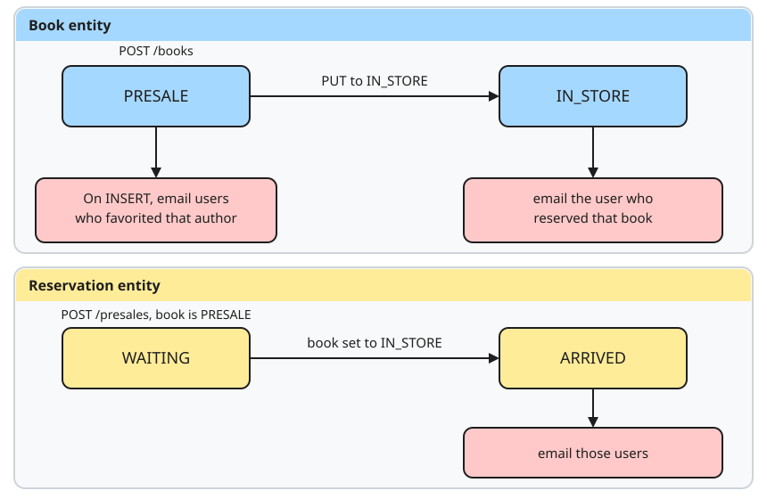

# Bookstore

Every request hits API Gateway, and API Gateway forwards all of them to one CRUD function. That function reads and writes the Bookstore table.

Changes in `Bookstore` leave through the table stream. One function emails the users who favorited an author when that author publishes a presale. The other emails when a reserved book arrives. See [Notifications](#notifications).

Books, presales, and favorites share one table, `Bookstore`. A book row, a reservation row, and a favorite row are different items. The key prefix tells them apart.

## Columns

`pk` and `sk` are the address of the row. `entity` says if the row is a book, a reservation, or a favorite.

`gsi1pk` and `gsi1sk` are the address of that same row inside the `byAuthor` index. `gsi2pk` and `gsi2sk` are the address inside the `byAuthorName` index. They are copies used for search. A presale or a favorite leaves `gsi2pk` and `gsi2sk` empty, so the name index returns only books.

`authorId` is one person. `authorName` is the name printed on the book. Two people can share a name. A favorite stores the person, not a book flag.

| Column | Book | Presale | Favorite | Holds |
|---|---|---|---|---|
| `pk` | yes | yes | yes | Address of the row. |
| `sk` | yes | yes | yes | Second part of that address. |
| `entity` | `BOOK` | `PRESALE` | `FAVORITE` | Book, reservation, or favorite. |
| `authorId` | yes | | yes | One person. On a favorite, the author that user chose. |
| `authorName` | yes | | | Name printed on the book. |
| `title` | yes | | | Book title. |
| `publishedAt` | yes | | | When it was published. |
| `userEmail` | | yes | yes | Address that reserved the book or favorited the author, and that receives notices. |
| `bookId` | | yes | | Which book they reserved. |
| `status` | `PRESALE` or `IN_STORE` | `WAITING` or `ARRIVED` | | See the next table. |
| `gsi1pk` | `AUTHOR#<authorId>` | `BOOK#<bookId>` | `FAVORITE#<authorId>` | `byAuthor` search key. |
| `gsi1sk` | the publish date | `USER#<userEmail>` | `USER#<userEmail>` | `byAuthor` order. |
| `gsi2pk` | `AUTHORNAME#<authorName>` | | | `byAuthorName` search key. |
| `gsi2sk` | the publish date | | | `byAuthorName` order. |

| Row | Status | Means |
|---|---|---|
| Book | `PRESALE` | Published, not in the store yet. A user can reserve it. |
| Book | `IN_STORE` | The book has arrived at the store. |
| Reservation | `WAITING` | Reserved, still waiting. |
| Reservation | `ARRIVED` | The book arrived. The arrival Lambda sends the notice. |

## Status changes

A `POST /books` starts the book at `PRESALE` or at `IN_STORE`. A user can reserve it only while it is `PRESALE`. That reservation starts at `WAITING`.

The change that links the two rows is putting the book in `IN_STORE`. The CRUD Lambda then sets every `WAITING` reservation of that book to `ARRIVED`, and the stream emails those addresses.

An `INSERT` of a `PRESALE` book does not change a reservation. It emails the users who favorited that author.

## Notifications

The `Bookstore` stream carries the row before the change and the row after it. Two functions read that stream and send mail through Amazon SES, from a verified address.

A reservation stores `userEmail`, not a user id. That address is who receives the notice.

The favorite-presale Lambda runs on an `INSERT` of a `BOOK` whose status is `PRESALE`. A user favorites an author with a row at `USER#<userEmail>` and `AUTHOR#<authorId>`. The email goes to each of those addresses. A reservation by itself does not make that user a favorite.

The book-arrived Lambda runs on a `MODIFY` that changes a `BOOK` from `PRESALE` to `IN_STORE`. The CRUD Lambda sets every reservation for that book to `ARRIVED`. This Lambda then emails each of those `userEmail` addresses.

## What you can look up

`byAuthor` answers three questions. A search for `AUTHOR#garcia-marquez` returns that author's books. A search for `BOOK#<id>` returns who reserved that book. A search for `FAVORITE#garcia-marquez` returns who favorited that author. The three never mix, because the search text is different.

| Look up | Where | You ask for | You get |
|---|---|---|---|
| One book | `pk`, `sk` | `BOOK#<id>` | That book. |
| One user's reservations | `pk`, `sk` | `USER#<userEmail>` and `sk` `BOOK#...` | That user's reservations. |
| One reservation | `pk`, `sk` | `USER#<userEmail>` and `BOOK#<bookId>` | That user's reservation of that book. |
| One user's favorites | `pk`, `sk` | `USER#<userEmail>` and `sk` `AUTHOR#...` | The authors that user favorited. |
| One favorite | `pk`, `sk` | `USER#<userEmail>` and `AUTHOR#<authorId>` | That user's favorite of that author. |
| Books by this author | `byAuthor` (`gsi1pk`, `gsi1sk`) | `AUTHOR#<authorId>` | That person's books, oldest first. |
| Who reserved this book | `byAuthor` (`gsi1pk`, `gsi1sk`) | `BOOK#<bookId>` | Those reservations. |
| Who favorited this author | `byAuthor` (`gsi1pk`, `gsi1sk`) | `FAVORITE#<authorId>` | Those users. |
| Books with this written name | `byAuthorName` (`gsi2pk`, `gsi2sk`) | `AUTHORNAME#<authorName>` | Every book with that name, oldest first. |

A search for "Ana García" returns every book with that printed name, including books from two different people. Search by `AUTHOR#<authorId>` when you already know which person.

## Example rows

Seven rows in `Bookstore`. An empty cell is an attribute that row does not store.

| pk | sk | entity | authorId | authorName | title | publishedAt | userEmail | bookId | status | gsi1pk | gsi1sk | gsi2pk | gsi2sk |
|---|---|---|---|---|---|---|---|---|---|---|---|---|---|
| `BOOK#33bb7fa9-bfeb-4810-bbb0-e3a06afd368f` | `BOOK#33bb7fa9-bfeb-4810-bbb0-e3a06afd368f` | `BOOK` | `garcia-marquez` | `Gabriel García Márquez` | `Cien años de soledad` | `1967-05-30T00:00:00Z` | | | `PRESALE` | `AUTHOR#garcia-marquez` | `1967-05-30T00:00:00Z` | `AUTHORNAME#Gabriel García Márquez` | `1967-05-30T00:00:00Z` |
| `BOOK#8651ef23-fee4-4caa-b269-52221311b780` | `BOOK#8651ef23-fee4-4caa-b269-52221311b780` | `BOOK` | `garcia-marquez` | `Gabriel García Márquez` | `El amor en los tiempos del cólera` | `1985-12-05T00:00:00Z` | | | `IN_STORE` | `AUTHOR#garcia-marquez` | `1985-12-05T00:00:00Z` | `AUTHORNAME#Gabriel García Márquez` | `1985-12-05T00:00:00Z` |
| `BOOK#e381f50c-48f5-4997-8b04-8fbfb36e6a57` | `BOOK#e381f50c-48f5-4997-8b04-8fbfb36e6a57` | `BOOK` | `borges` | `Jorge Luis Borges` | `Ficciones` | `1944-01-01T00:00:00Z` | | | `PRESALE` | `AUTHOR#borges` | `1944-01-01T00:00:00Z` | `AUTHORNAME#Jorge Luis Borges` | `1944-01-01T00:00:00Z` |
| `USER#ana@example.com` | `BOOK#e381f50c-48f5-4997-8b04-8fbfb36e6a57` | `PRESALE` | | | | | `ana@example.com` | `e381f50c-48f5-4997-8b04-8fbfb36e6a57` | `WAITING` | `BOOK#e381f50c-48f5-4997-8b04-8fbfb36e6a57` | `USER#ana@example.com` | | |
| `USER#leo@example.com` | `BOOK#e381f50c-48f5-4997-8b04-8fbfb36e6a57` | `PRESALE` | | | | | `leo@example.com` | `e381f50c-48f5-4997-8b04-8fbfb36e6a57` | `WAITING` | `BOOK#e381f50c-48f5-4997-8b04-8fbfb36e6a57` | `USER#leo@example.com` | | |
| `USER#ana@example.com` | `BOOK#33bb7fa9-bfeb-4810-bbb0-e3a06afd368f` | `PRESALE` | | | | | `ana@example.com` | `33bb7fa9-bfeb-4810-bbb0-e3a06afd368f` | `ARRIVED` | `BOOK#33bb7fa9-bfeb-4810-bbb0-e3a06afd368f` | `USER#ana@example.com` | | |
| `USER#ana@example.com` | `AUTHOR#garcia-marquez` | `FAVORITE` | `garcia-marquez` | | | | `ana@example.com` | | | `FAVORITE#garcia-marquez` | `USER#ana@example.com` | | |
